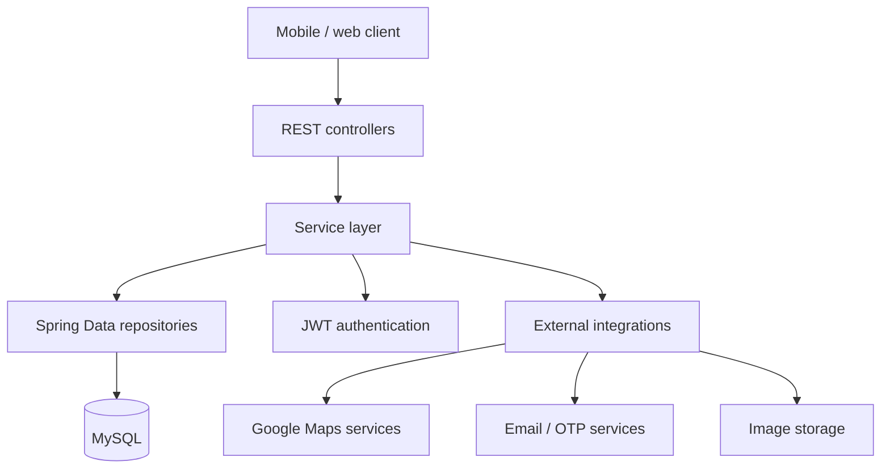

# Calma API — Salon Booking Backend

Calma API is the Spring Boot backend for the Calma salon-booking application. It exposes REST endpoints and organizes application logic into controllers, services, repositories, entities, DTOs, authentication, and integration components.

## Core capabilities in this repository

- User registration, login, logout, and user profile/location operations
- JWT-based request authentication and token blacklisting for logout
- User types and access rules for salon-owner workflows
- Salon registration and management
- Salon services, reviews, and salon discovery
- Address geocoding and distance/directions-related models
- Image upload and storage support
- Email and OTP-related components

These capabilities are based on the checked-in source tree; exact availability and configuration depend on the active application profile.

## Technology

| Area | Technologies |
|---|---|
| Language / framework | Java, Spring Boot 3.2.2 |
| Web / persistence | Spring Web, Spring Data JPA, Hibernate |
| Security | Spring Security, JWT (JJWT), BCrypt |
| Database | MySQL Connector/J |
| Integrations | Google Maps services, Twilio |
| Media / files | Image upload service and configurable storage |
| Communication | Spring Mail |
| Utilities | Jackson, ModelMapper, Lombok |
| Build | Maven |

**Version note:** `pom.xml` declares Java 11, but Spring Boot 3.2.x requires Java 17 or later. Align the Maven Java version with the JDK used to build and run the application before relying on the setup instructions.

## Architecture



## API areas

The following routes are visible in the current controller source:

| Method | Route | Purpose |
|---|---|---|
| POST | `/api/register` | Register a user |
| POST | `/api/login` | Authenticate a user |
| POST | `/api/logout` | Log out and invalidate a token |
| GET | `/api/user/{userId}` | Retrieve user details |
| PUT | `/api/updateLocation/{userId}` | Update a user's location |
| POST | `/api/salons/{salonOwnerId}` | Register a salon |
| PUT | `/api/salons/{salonId}` | Update a salon |
| POST | `/api/salons/{salonId}/services` | Add services to a salon |
| DELETE | `/api/salons/{salonId}/services/{serviceName}` | Remove a salon service |

Check the controller classes for request payloads, response formats, and the latest route behaviour.

## Project structure

```text
src/main/java/com/calmaapp/
├── Config/
├── Controller/
├── authentication/
├── constants/
├── entity/
├── exception/
├── mappingdistnace/
├── payloads/
├── repository/
├── service/
└── userService/
```

## Run locally

### Prerequisites

- JDK 17 or later for Spring Boot 3.2.x
- Maven
- MySQL
- Credentials for any external integrations used by the selected profile

### Configure

Application settings are under `src/main/resources/`:

- `application.properties`
- `application.dev.properties`
- `application.prod.properties`

Before running, configure database access, JWT signing, image storage, and any enabled external integration credentials through environment-specific configuration. Do not commit secrets to Git.

### Build and test

```bash
mvn clean test
mvn package
```

### Start

```bash
mvn spring-boot:run
```

The application will only start successfully when the Java version, database, and active profile configuration are compatible.

## Security and repository maintenance

**Important:** The current tracked source contains credential-like values in configuration and a service class, including JWT, Firebase, and Google API keys. Treat exposed credentials as compromised: revoke or rotate them with their providers, move replacements to environment variables or a secrets manager, and remove the old values from tracked files and Git history as appropriate. Do not copy these values into issues, screenshots, documentation, or commits.

Also review the current authorization rules, token lifecycle, file-upload validation, and database configuration before deploying the application publicly.

## Scope

This README describes the repository's checked-in structure and dependencies. It does not claim that production deployment, integration credentials, automated tests, or all workflows have been independently verified.
